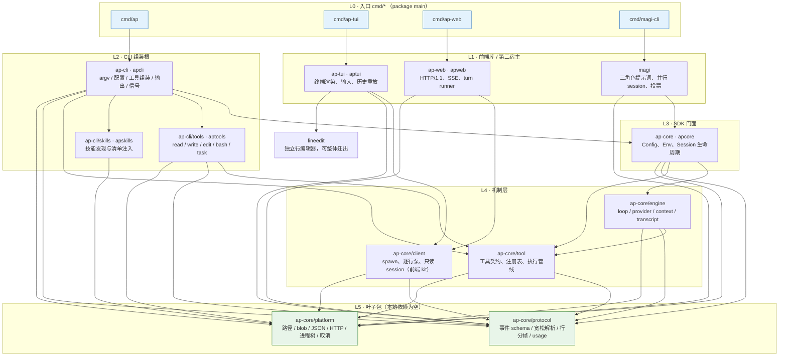
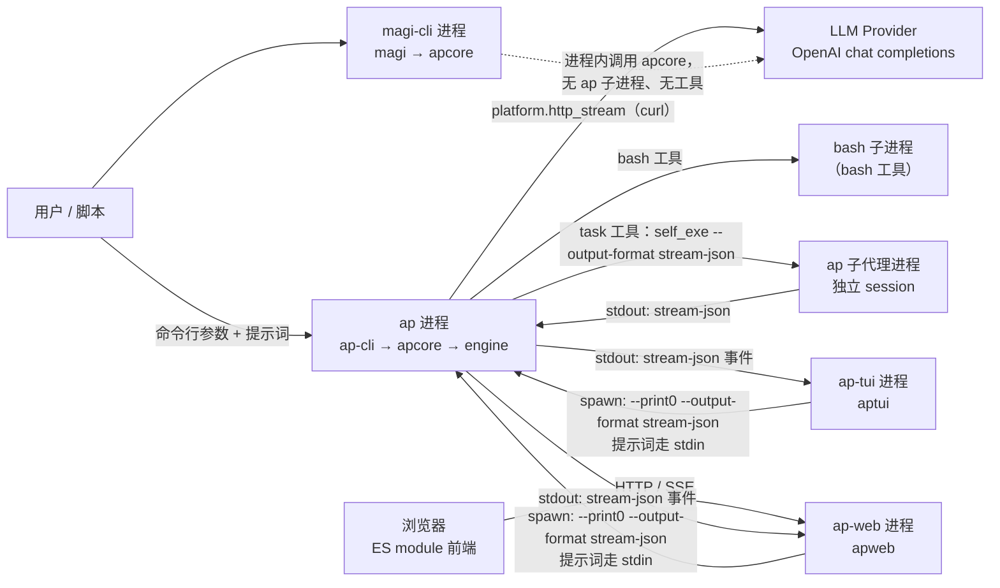
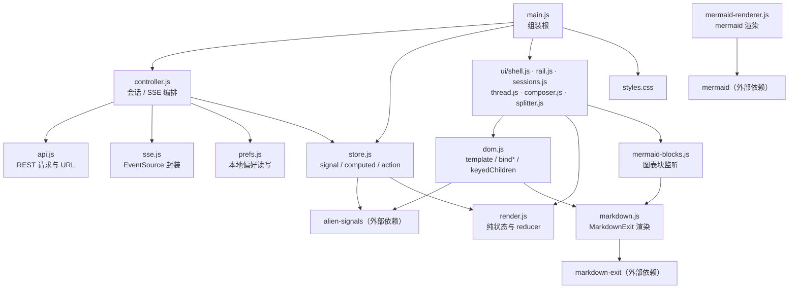

# ap 模块依赖图（代码实证分析）

本文从**源码实际 import 语句**出发，画出 ap 的模块级依赖图，并与规格中的允许边做交叉验证。文中描述了两类容易混淆的关系：

- **编译期依赖**：Odin 的 `import` 边，决定哪个二进制链接哪些代码。
- **运行期关系**：进程之间的 spawn 与 stdin/stdout 事件通道。前端不链接 agent 代码，因此运行期关系在依赖图上没有对应的 import 边。

本文是分析记录，不是规格。权威的允许边清单见 [docs/internal/dependencies.md](../internal/dependencies.md)，模块契约见 [docs/internal/architecture.md](../internal/architecture.md)。

## 分析方法

1. 遍历仓库内所有 `*.odin` 文件，抽取以 `import` 开头的行，把相对路径归一化到包级节点（忽略 `core:`、`base:`、`vendor:` 标准库/供应商前缀），分别统计代码文件与 `*_test.odin` 的本地 import 边。
2. 检查四个 `cmd/*` 入口，确认入口只做 `os.exit(<库>.run(os.args))`。
3. 检查浏览器前端 `ap-web/frontend/*.js` 与 `ap-web/frontend/ui/*.js` 的 ES module import 边（独立于 Odin 依赖图）。
4. 运行 `tools/check-deps.sh`，输出 `check-deps: ok`；该脚本同时用 `-export-dependencies:json` 断言 `ap-web`、`ap-tui` 的编译文件清单里不出现 `ap-core/engine/`。

结论：**源码中的本地 import 边与 `docs/internal/dependencies.md` 的白名单完全一致，没有违规边**。测试文件也没有引入任何生产代码不允许的边。

## 一、编译期模块依赖图

箭头方向为 `import` 方向（依赖方 → 被依赖方），自上而下分层。同一层内没有互相依赖。

### 源码实证：生产代码的本地 import 边

下表列出图中每条边的实际引用次数（按 `*.odin` 文件中的 import 语句计数，不含 `*_test.odin`）。次数反映引用广度，不改变边的存在性。

| 依赖方 | 被依赖方 | import 次数 | 归一化前的路径 |
| --- | --- | ---: | --- |
| `cmd/ap` | `ap-cli` | 1 | `../../ap-cli` |
| `cmd/ap-tui` | `ap-tui` | 1 | `../../ap-tui` |
| `cmd/ap-web` | `ap-web` | 1 | `../../ap-web` |
| `cmd/magi-cli` | `magi` | 1 | `../../magi` |
| `ap-cli` | `ap-core` | 4 | `../ap-core` |
| `ap-cli` | `ap-cli/tools` | 2 | `tools` |
| `ap-cli` | `ap-cli/skills` | 1 | `skills` |
| `ap-cli` | `ap-core/tool` | 1 | `../ap-core/tool` |
| `ap-cli` | `ap-core/protocol` | 3 | `../ap-core/protocol` |
| `ap-cli` | `ap-core/platform` | 10 | `../ap-core/platform` |
| `ap-cli/tools` | `ap-core/tool` | 5 | `../../ap-core/tool` |
| `ap-cli/tools` | `ap-core/protocol` | 1 | `../../ap-core/protocol` |
| `ap-cli/tools` | `ap-core/platform` | 6 | `../../ap-core/platform` |
| `ap-cli/skills` | `ap-core/platform` | 1 | `../../ap-core/platform` |
| `magi` | `ap-core` | 3 | `../ap-core` |
| `magi` | `ap-core/platform` | 6 | `../ap-core/platform` |
| `ap-tui` | `ap-core/client` | 9 | `../ap-core/client` |
| `ap-tui` | `ap-core/protocol` | 2 | `../ap-core/protocol` |
| `ap-tui` | `lineedit` | 2 | `../lineedit` |
| `ap-web` | `ap-core/client` | 7 | `../ap-core/client` |
| `ap-web` | `ap-core/protocol` | 3 | `../ap-core/protocol` |
| `ap-core` | `ap-core/engine` | 1 | `engine` |
| `ap-core` | `ap-core/tool` | 1 | `tool` |
| `ap-core` | `ap-core/protocol` | 1 | `protocol` |
| `ap-core` | `ap-core/platform` | 1 | `platform` |
| `ap-core/engine` | `ap-core/tool` | 4 | `../tool` |
| `ap-core/engine` | `ap-core/protocol` | 2 | `../protocol` |
| `ap-core/engine` | `ap-core/platform` | 10 | `../platform` |
| `ap-core/tool` | `ap-core/protocol` | 1 | `../protocol` |
| `ap-core/tool` | `ap-core/platform` | 4 | `../platform` |
| `ap-core/client` | `ap-core/protocol` | 2 | `../protocol` |
| `ap-core/client` | `ap-core/platform` | 3 | `../platform` |

`ap-core/platform` 与 `ap-core/protocol` 只 import `core:`/`base:`/`vendor:`，`lineedit` 同理（其 `lineedit/example/main.odin` 的 `..` 是示例目录向上引用本包，不属于 `lineedit/*.odin` 的检查范围）。

### 图中没有的边及其原因

这些"缺失的边"是架构约束的核心，而不是分析遗漏：

| 不存在的边 | 原因 |
| --- | --- |
| `ap-cli` → `ap-core/engine` | 宿主只通过 `apcore` 门面使用 agent 机制，SDK 才能被第二个宿主（`magi`）复用 |
| `ap-core/engine` → `apcore` / `ap-cli` / 前端 | 机制层不认识应用层；agent 定义、技能、具体工具都不进入 engine |
| `ap-core/tool` → `engine` | 工具契约只定义 `Tool` / `Registry` / 执行管线，具体工具在 `ap-cli/tools` |
| `ap-tui` / `ap-web` → `engine` / `platform` / `apcore` / `ap-cli` | 前端二进制不能链接 agent 代码；由检查器的编译文件清单断言 |
| `ap-web` → `lineedit` | 行编辑器只授权给 `ap-tui` |
| `magi` → `engine` / `ap-cli` / `client` / 前端 | `magi` 是 `apcore` 的第二个宿主，不与 CLI 共享代码，不执行工具 |

## 二、运行期进程关系图

编译期依赖图上，前端与 agent 之间没有边；运行期它们通过子进程协议通信。`ap-tui` 与 `ap-web` 每轮拉起一个 `ap` 进程，`task` 工具也拉起一个 `ap` 子进程（子代理）。

要点：

- 前端只理解 `ap-core/protocol` 的宽松事件结构和 `ap-core/client` 的进程辅助；`stream-json` 的原始 JSON 行由 SSE 原样转发，避免重新序列化丢字段。
- `task` 工具用当前可执行文件（`self_exe`）启动子代理，参数里带 `--output-format stream-json`，子代理拥有独立 session 和 transcript。
- `bash` 和 `task` 启动的进程树都要在取消时终止；`ap-core/client` 在前端侧取消时终止 `ap` 子进程树，等待 3 秒后再强杀。
- `magi` 为三个角色各开一个隔离 session，全部在进程内完成，不 spawn `ap`、不注册工具。

## 三、浏览器前端 ES module 依赖图

`ap-web/frontend/` 是独立构建的 JS 模块图（esbuild 打包进 `ap-web/dist`），与上面的 Odin 图没有 import 边，只有 HTTP/SSE 运行期通道。

`render.js` 只产出纯状态，`store.js` 负责发布到 signal 并维护 UI 状态，`controller.js` 负责会话与 SSE 编排且不碰 DOM，`ui/*` 只把信号绑定到 DOM——这条分界与 Odin 侧的「`context_build` 是纯函数」是同类思路。`mermaid-renderer.js` 由 `mermaid-blocks.js` 在第一次出现图表时按需加载，不由主 bundle 直接 import。

## 四、依赖方向为什么成立

依赖图单向的原因是以下几条约束，全部由 `tools/check-deps.sh` 在构建期强制：

1. **SDK 门面隔离宿主**：`apcore` 只接收显式 `Config`，不读 argv、环境变量或 `settings.json`，不写 stdout，不装信号，不调用 `os.exit`。所以 `ap-cli` 与 `magi` 可以并列作为宿主。
2. **机制与应用分离**：`engine` 只依赖 `tool`、`platform`、`protocol`；技能、`AGENTS.md`、agent 定义、五个具体工具都在 `ap-cli` 侧。
3. **工具层不反向依赖**：`Tool.user` 把宿主配置当作不透明指针，`tool` 包无需认识具体工具或 engine。
4. **叶子包**：`platform` 与 `protocol` 的本地依赖为空，`lineedit` 只允许标准库。
5. **前端零 agent 代码**：检查器对 `cmd/ap-web`、`cmd/ap-tui` 导出编译文件清单，断言其中不出现 `ap-core/engine/`。

## 五、验证记录

| 检查 | 命令 | 结果 |
| --- | --- | --- |
| 包边界与前端编译清单 | `tools/check-deps.sh` | `check-deps: ok` |
| 本地 import 边与白名单比对 | 逐文件扫描 `*.odin` | 生产代码与测试代码均无越界边 |
| 入口薄封装 | 检查 `cmd/*/main.odin` | 四个入口均只有 `os.exit(<库>.run(os.args))` |

如果后续增删模块，先改 [dependencies.md](../internal/dependencies.md) 与 `tools/check-deps.sh`（以及 PowerShell 版本），再改代码；不要用 import 别名或注释绕过检查器。

## 相关文档

- [architecture.md](../internal/architecture.md)：模块职责、进程模型、契约
- [dependencies.md](../internal/dependencies.md)：包布局与允许的 import 边
- [integration.md](../internal/integration.md)：前端接入 ap 的进程契约
- [web-ui-v3.md](web-ui-v3.md)：浏览器前端界面方案
